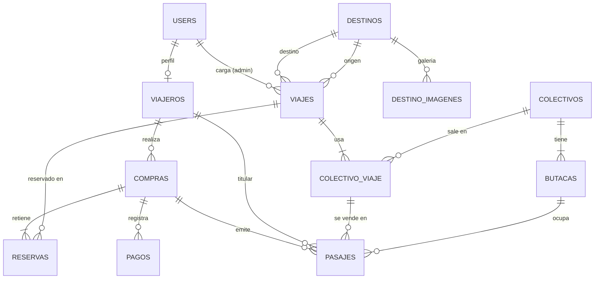

# VíaAliwén

Sistema web de venta de pasajes de colectivo de **VíaAliwén**, una empresa (ficticia) de transporte turístico de la provincia del Neuquén. Trabajo Final de **Programación Web Dinámica**.

Los viajeros consultan destinos y galerías de fotos, eligen viaje y butaca en un mapa del colectivo, pagan con **Mercado Pago** (modo de prueba) y descargan un **pasaje en PDF** por cada viaje. El administrador-vendedor gestiona destinos, colectivos y viajes y consulta estadísticas de ventas.

> "Aliwén" significa "árbol" en mapuzungun.

---

## Índice

1. [Objetivo](#1-objetivo)
2. [Tecnologías](#2-tecnologías)
3. [Requisitos](#3-requisitos)
4. [Instalación](#4-instalación)
5. [Configuración del archivo `.env`](#5-configuración-del-archivo-env)
6. [Mercado Pago en modo de prueba](#6-mercado-pago-en-modo-de-prueba)
7. [Migraciones, seeders y otros comandos](#7-migraciones-seeders-y-otros-comandos)
8. [Usuarios de prueba](#8-usuarios-de-prueba)
9. [Funcionalidades](#9-funcionalidades)
10. [Modelo de datos](#10-modelo-de-datos)
11. [Relaciones Eloquent](#11-relaciones-eloquent)
12. [Perfiles y permisos](#12-perfiles-y-permisos)
13. [Funcionalidad AJAX](#13-funcionalidad-ajax)
14. [Librerías externas](#14-librerías-externas)
15. [Pruebas automatizadas](#15-pruebas-automatizadas)
16. [Requisitos académicos: dónde se cumple cada uno](#16-requisitos-académicos-dónde-se-cumple-cada-uno)
17. [Estructura del proyecto](#17-estructura-del-proyecto)
18. [Créditos de las fotos](#18-créditos-de-las-fotos)

---

## 1. Objetivo

Permitir que una empresa de transporte venda **sus propios pasajes** por internet:

- Que cualquier visitante pueda consultar destinos, fotos, viajes, horarios y precios.
- Que un viajero registrado compre uno o varios pasajes en una misma operación, eligiendo su butaca, pagando con Mercado Pago y obteniendo un PDF por pasaje.
- Que la empresa administre destinos, colectivos y viajes, y obtenga estadísticas reales de ventas.

El diseño completo (análisis del modelo propuesto, problemas encontrados y modelo definitivo) está en [`docs/ETAPA-1-analisis-y-diseno.md`](docs/ETAPA-1-analisis-y-diseno.md).

## 2. Tecnologías

| Tecnología | Versión | Uso |
|---|---|---|
| PHP | 8.3 o superior (probado con 8.4) | Lenguaje principal |
| Laravel | 13 | Framework MVC: rutas, controladores, middleware, Form Requests, policies |
| Blade | incluido en Laravel | Vistas, layouts, partials y componentes |
| Eloquent ORM | incluido en Laravel | Todo el acceso a datos y las relaciones |
| MySQL / MariaDB | MariaDB 10.11 (XAMPP) | Base de datos relacional (administrada con HeidiSQL) |
| Bootstrap | 5.3.8 + Bootstrap Icons 1.13 | Diseño responsive |
| JavaScript + `fetch` | — | Búsqueda dinámica de viajes y refresco del mapa de butacas |
| Vite | 8 | Compila CSS/JS y descarga las fuentes para servirlas desde el proyecto |
| `mercadopago/dx-php` | 3.16 | SDK oficial de Mercado Pago (Checkout Pro) |
| `barryvdh/laravel-dompdf` | 3.1 | Pasajes en PDF |
| PHPUnit | 12 | Pruebas automatizadas |

> El enunciado menciona `mercadopago/sdk-php`, pero **ese nombre no existe en Packagist**: es el nombre del repositorio de GitHub. El paquete oficial se instala como `mercadopago/dx-php`.

## 3. Requisitos

- **PHP 8.3+** con las extensiones `pdo_mysql`, `mbstring`, `openssl`, `curl`, `gd`, `intl`, `fileinfo` y `zip`.
  - Para conectarse con Mercado Pago, PHP necesita certificados raíz configurados: `curl.cainfo` y `openssl.cafile` en el `php.ini`. El PHP de XAMPP ya los trae.
- **Composer 2**.
- **Node.js 20+** y npm.
- **MySQL o MariaDB**, por ejemplo el de XAMPP.
- Una cuenta de **Mercado Pago Developers** para las credenciales de prueba (ver [sección 6](#6-mercado-pago-en-modo-de-prueba)).

## 4. Instalación

```bash
git clone <url-del-repositorio> TP-Final-PWD
cd TP-Final-PWD

composer install
npm install
npm run build          # compila Bootstrap, el JS y las fuentes en public/build

cp .env.example .env   # en Windows (cmd): copy .env.example .env
php artisan key:generate
```

1. Creá una base de datos vacía llamada `viaaliwen` (utf8mb4) en HeidiSQL o phpMyAdmin. También podés dejar que la cree el comando `migrate`: preguntará si querés crearla.
2. Revisá los datos de conexión en `.env` (ver [sección 5](#5-configuración-del-archivo-env)).
3. Ejecutá:

```bash
php artisan migrate --seed   # crea las tablas y carga los datos de prueba (fotos incluidas)
php artisan storage:link     # publica las fotos de las galerías en public/storage
php artisan serve            # http://127.0.0.1:8000
```

## 5. Configuración del archivo `.env`

El archivo `.env` **no se sube al repositorio** (está en `.gitignore`). Se parte de `.env.example`.

| Variable | Valor sugerido | Descripción |
|---|---|---|
| `APP_URL` | `http://localhost:8000` | URL base (se usa para las URL de las fotos) |
| `APP_LOCALE` | `es` | Idioma de la aplicación y de los mensajes de validación |
| `DB_CONNECTION` | `mysql` | Funciona igual con MariaDB |
| `DB_HOST` / `DB_PORT` | `127.0.0.1` / `3306` | Si en tu PC el MySQL de XAMPP usa otro puerto (por ejemplo `3307`), cambialo acá |
| `DB_DATABASE` | `viaaliwen` | |
| `DB_USERNAME` / `DB_PASSWORD` | `root` / *(vacía en XAMPP)* | |
| `MERCADOPAGO_ACCESS_TOKEN` | `TEST-...` o `APP_USR-...` de prueba | Credencial privada; nunca se envía al navegador |
| `MERCADOPAGO_WEBHOOK_SECRET` | *(opcional)* | Valida la firma `x-signature` de las notificaciones |
| `MERCADOPAGO_URL_PUBLICA` | *(vacía en local)* | URL https pública (túnel o servidor) para la vuelta automática y los webhooks |
| `MERCADOPAGO_SANDBOX` | `auto` | Elige `sandbox_init_point` o `init_point` según el token |
| `RESERVA_MINUTOS` | `15` | Minutos que se retienen las butacas mientras se paga |

## 6. Mercado Pago en modo de prueba

La guía paso a paso está en [`docs/MERCADOPAGO.md`](docs/MERCADOPAGO.md). En resumen:

1. En <https://www.mercadopago.com.ar/developers/panel/app>, creá una aplicación de **Checkout Pro**: API de preferencias, sin plataforma de e-commerce.
2. Copiá el **Access Token de prueba** en `MERCADOPAGO_ACCESS_TOKEN` y ejecutá `php artisan config:clear`.
3. Comprá un pasaje. En la página de la compra, **Pagar con Mercado Pago** abre el checkout en una **pestaña nueva**; ahí elegí **Tarjeta**:

| Tarjeta de prueba | Número | CVV | Vencimiento | Titular | Resultado |
|---|---|---|---|---|---|
| Mastercard | 5031 7557 3453 0604 | 123 | 11/30 | `APRO` | Aprobado |
| Mastercard | 5031 7557 3453 0604 | 123 | 11/30 | `OTHE` | Rechazado |

Documento del titular: DNI 12345678.

4. Volvé a la pestaña del sitio. La página de la compra consulta a Mercado Pago cada pocos segundos (`GET /mis-compras/{id}/estado`, JSON) y, cuando el pago se aprueba, se actualiza sola y muestra los pasajes.

**Cómo se confirma un pago** (y por qué es seguro):

- **No se confía en el navegador.** El estado que trae la URL de vuelta no se usa: el pago se consulta a la API de Mercado Pago con `PaymentClient::get()` o se busca por `external_reference`.
- **Mercado Pago no acepta `localhost`** en `back_urls` ni en las notificaciones. En local, la confirmación se hace al abrir la compra o con el botón **Verificar pago**. Con una URL pública se suman la vuelta automática y el webhook (`POST /webhooks/mercadopago`, con validación de firma).
- **Los pasajes se generan sólo** con el pago `approved` y el monto correcto. Antes de generarlos se vuelve a bloquear el viaje y a comprobar que las butacas sigan libres.
- **Idempotencia:** procesar el mismo pago varias veces no duplica pasajes. `mp_payment_id` es único, la compra se bloquea durante el proceso y, si ya está aprobada, no se repite nada.

Probado en vivo con la cuenta de prueba: un pago aprobado emitió su pasaje y uno rechazado quedó registrado sin emitir nada.

## 7. Migraciones, seeders y otros comandos

```bash
php artisan migrate              # crea las tablas
php artisan db:seed              # carga los datos de prueba
php artisan migrate:fresh --seed # borra todo y vuelve a crear la base con datos de prueba
php artisan compras:vencer       # marca como vencidas las compras con la reserva expirada (también ocurre solo)
php artisan schedule:work        # (opcional) corre compras:vencer cada 5 minutos
php artisan test                 # pruebas automatizadas (usan SQLite en memoria, no tocan tu base)
npm run dev                      # Vite en modo desarrollo (recarga automática de estilos)
```

**Datos de prueba que cargan los seeders:**

- **10 destinos** neuquinos con galerías de fotos libres de Wikimedia Commons.
- **6 colectivos** con sus butacas; uno está dado de baja.
- **Unos 150 viajes:** realizados en los últimos 60 días y programados para los próximos 20.
- **Un historial de ventas de demostración**, para que el panel tenga estadísticas.
- **Casos especiales para la defensa:**
  - Un viaje con todas las butacas vendidas.
  - Un viaje cuyo único colectivo está dado de baja.
  - Un viaje con dos colectivos asignados.

  Ninguno de los dos primeros aparece como disponible.

> Las ventas de demostración son datos de prueba: no pasaron por Mercado Pago (`pagos.mp_payment_id` queda en NULL y el medio figura como "datos de prueba").

## 8. Usuarios de prueba

Todas las contraseñas son **`password`**. Son ficticias y sólo sirven en este proyecto.

|        Perfil          |        Correo         | Para probar |
|------------------------|-----------------------|-------------|
| Administrador-vendedor |`admin@viaaliwen.test` | Panel, CRUD, estadísticas; carga los viajes que salen de Neuquén |
| Administrador-vendedor |`ventas@viaaliwen.test`|Carga el resto de los viajes: muestra que cada admin sólo edita los suyos|
|        Viajero         | `lucia.gomez@viaaliwen.test` | Tiene historial: una compra con ida y vuelta y un viaje próximo |
|        Viajero         | `martin.paz@viaaliwen.test`  | Tiene un viaje realizado |
|        Viajero         | `ana.quiroga@viaaliwen.test` | Cuenta sin compras, para probar el circuito completo |

Además hay 60 viajeros ficticios generados con Faker, que figuran como compradores en el historial de ventas.

## 9. Funcionalidades

**Visitante (sin sesión)**
- Inicio con buscador, destinos destacados y próximas salidas.
- Destinos con descripción de sus atractivos y galería de fotos (carrusel con miniaturas).
- Listado de viajes disponibles, agrupado por día, con búsqueda dinámica por destino, origen y fecha.
- Detalle de cada viaje: origen, destino, salida, llegada estimada, duración, precio, colectivos asociados y mapa de butacas.
- Si intenta comprar, se le pide ingresar o registrarse; después de ingresar vuelve al viaje.

**Viajero**
- **Cuenta:** registro (nombre, apellido, DNI, correo, fecha de nacimiento y contraseña), ingreso y cierre de sesión.
- **Mis datos:** puede editar su nombre, apellido y fecha de nacimiento; el DNI y el correo no se modifican.
- **Butaca:** la elige en el mapa del colectivo. El mapa se refresca solo cuando otra persona compra o reserva una butaca.
- **Carrito:** varios viajes en una misma operación, una butaca por viaje. Muestra destino, origen, horario, fecha, colectivo, butaca, precio individual y total, y permite quitar viajes o seguir comprando.
- **Pago:** al ir a pagar, las butacas quedan reservadas 15 minutos. El checkout de Mercado Pago se abre en una pestaña nueva, y la página de la compra se actualiza sola cuando el pago se aprueba.
- **Mis compras:**
  - Estado de cada compra y los intentos de pago informados por Mercado Pago.
  - Con el pago pendiente: botones Pagar con Mercado Pago (pestaña nueva), Verificar pago y Cancelar.
  - Descarga de un PDF por cada pasaje.

**Administrador-vendedor**
- **Destinos:** CRUD completo y galería (subida múltiple de fotos con epígrafe y crédito, y baja de fotos). No se elimina un destino que tenga viajes.
- **Colectivos:**
  - Alta, edición, baja y reactivación; la patente se valida (ABC123 o AB123CD).
  - Butacas: se generan al crear el colectivo y se ajustan al cambiar la capacidad. No se puede achicar si alguna butaca quitada tiene pasajes.
  - Ficha con el mapa de butacas y la ocupación en cada viaje programado.
  - Sólo se elimina un colectivo que nunca se usó.
- **Viajes:**
  - Alta con llegada estimada cargada a mano y colectivos asociados.
  - Edición: con pasajes vendidos sólo se puede cambiar el precio.
  - Eliminación: sólo sin ventas ni pagos en curso.
  - Asignar y quitar colectivos (`attach`/`detach`), validando el estado del colectivo y que no se superponga con otro viaje en el horario.
  - Detalle con la ocupación de cada colectivo y los pasajes vendidos.
- **Viajeros:** consulta y búsqueda, sólo de lectura.
- **Estadísticas:**
  - Totales de viajes (programados y realizados), destinos, colectivos operativos, pasajes vendidos y recaudación.
  - Ventas por destino y según el origen del viaje.
  - Pasajes vendidos por viaje, con su ocupación.

**Disponibilidad** (`App\Services\DisponibilidadService`): no se guarda en la base, se calcula.

- Butacas ocupadas = vendidas + reservadas por compras con el pago en curso y no vencidas.
- Un colectivo dado de baja tiene 0 butacas libres.
- Un viaje está disponible si todavía no salió y algún colectivo operativo tiene lugar.
- Se vuelve a comprobar al iniciar el pago y al confirmarlo, dentro de una transacción con bloqueo (`lockForUpdate`), para que dos compradores no se lleven la misma butaca.

## 10. Modelo de datos

Doce tablas propias (más las internas de Laravel: `sessions`, `cache`, `jobs`, `password_reset_tokens`):

| Tabla | Contenido | Restricciones destacadas |
|---|---|---|
| `users` | Credenciales y rol (`admin` / `viajero`) | email único |
| `viajeros` | Datos personales del comprador (1:1 con `users`) | DNI único, `user_id` único |
| `destinos` | Localidades: nombre, atractivos, destacado | nombre único |
| `destino_imagenes` | Galería de cada destino | se borra con el destino |
| `colectivos` | Número interno, patente, capacidad, estado | número y patente únicos |
| `butacas` | Asientos de cada colectivo (1..capacidad) | único (colectivo, número) |
| `viajes` | Origen y destino (ambos FK a `destinos`), precio, salida, llegada estimada, admin que lo cargó | |
| `colectivo_viaje` | Tabla intermedia N:M (equivale a SALE del enunciado) | PK compuesta (viaje, colectivo) |
| `compras` | Operación de pago; `referencia` = `external_reference` de Mercado Pago | referencia única |
| `reservas` | Butacas retenidas mientras el pago está pendiente | |
| `pagos` | Cada intento informado por Mercado Pago | `mp_payment_id` único (idempotencia) |
| `pasajes` | Pasajes emitidos, con el precio pagado | único (viaje, colectivo, butaca); FK compuesta a `colectivo_viaje` y a `butacas` |



**Cambios respecto del modelo propuesto** (justificados en `docs/ETAPA-1-analisis-y-diseno.md`):

- **SALE:** se quitaron las columnas que repetía de VIAJE (cumplía mal la 3FN).
- **Origen:** pasó a ser una FK.
- **Fecha y hora:** cada par de columnas se unificó en un `DATETIME`.
- **Butacas:** pertenecen a cada colectivo y su disponibilidad se calcula, no se guarda.
- **PASAJE:** ahora referencia al viaje.
- **Tablas nuevas:** se agregaron `compras`, `reservas` y `pagos`.

Las dos FK compuestas de `pasajes` hacen que la propia base de datos impida dos cosas: vender en un colectivo no asignado a ese viaje, y vender una butaca que no existe en ese colectivo.

## 11. Relaciones Eloquent

| Relación | Tipo | Dónde se usa |
|---|---|---|
| `Destino::viajes()` / `Viaje::destino()` | 1:N · `hasMany` / `belongsTo` | Viajes de cada destino, filtros |
| `Destino::viajesDesde()` / `Viaje::origen()` | 1:N | Origen del viaje, estadísticas por origen |
| `Viaje::colectivos()` / `Colectivo::viajes()` | **N:M** · `belongsToMany` (tabla `colectivo_viaje`) | `attach()` al crear o asignar, `detach()` al quitar, disponibilidad |
| `User::viajero()` / `Viajero::user()` | **1:1** · `hasOne` / `belongsTo` | Registro, perfil, nombre en el menú |
| `User::viajesCargados()` / `Viaje::creador()` | 1:N | Policy "sólo el admin que lo cargó" |
| `Viajero::pasajes()` / `Pasaje::viajero()` | 1:N | Historial, PDF, policy de descarga |
| `Colectivo::pasajes()` / `Pasaje::colectivo()` | 1:N | Reducir capacidad, PDF |
| `Colectivo::butacas()` / `Butaca::colectivo()` | 1:N | Mapa de butacas, sincronización con la capacidad |
| `Destino::imagenes()` / `DestinoImagen::destino()` | 1:N | Galerías |
| `Viajero::compras()`, `Compra::reservas()`, `Compra::pagos()`, `Compra::pasajes()` | 1:N | Checkout, confirmación, historial |
| `Destino::pasajes()` / `Destino::pasajesDesde()` | `hasManyThrough` (Destino → Viaje → Pasaje) | Estadísticas con `withCount` y `withSum` |

Scopes del modelo: `Viaje::programados()`, `Viaje::realizados()`, `Colectivo::operativos()`, `Compra::vigentes()`, `Destino::destacados()`.

## 12. Perfiles y permisos

| Sección | Visitante | Viajero | Administrador |
|---|:---:|:---:|:---:|
| Inicio, destinos, galerías, viajes, búsqueda | ✔ | ✔ | ✔ |
| Registro / ingreso | ✔ | — | — |
| Carrito, pago, Mis compras, Mis datos, PDF | → ingreso | ✔ | 403 |
| Panel administrativo (CRUD y estadísticas) | → ingreso | 403 | ✔ |
| Editar o eliminar un viaje | — | — | sólo el que lo cargó |

Cómo se implementa:

- **Middleware.** `auth` y el propio `rol` (`App\Http\Middleware\EnsureUserHasRole`, alias registrado en `bootstrap/app.php`), aplicados por grupos en `routes/web.php`.
- **Policies.** `ViajePolicy` (sólo el creador edita; no se borra con ventas), `CompraPolicy` y `PasajePolicy` (sólo el dueño).
- **Otros controles:**
  - El rol nunca se asigna desde un formulario: no es asignable masivamente.
  - "Mis datos" no recibe ningún id por la URL: siempre usa al viajero autenticado.
  - Los precios se leen siempre de la base, así nadie puede cambiarlos desde el navegador.
  - Todos los formularios tienen CSRF y las contraseñas se guardan con hash.
  - El login acepta 5 intentos por minuto.
  - El webhook está excluido de CSRF y se valida con firma.

## 13. Funcionalidad AJAX

**Búsqueda dinámica de viajes**: página *Viajes*, archivo `resources/js/busqueda-viajes.js`.

1. El usuario escribe en la barra (espera 300 ms entre teclas) o cambia origen, destino o fecha.
2. JavaScript hace `fetch('/viajes/buscar?q=...&destino_id=...')` con `Accept: application/json` y cancela la búsqueda anterior (`AbortController`).
3. `ViajeController@buscar` valida los parámetros con `BuscarViajesRequest` y consulta con Eloquent (`whereHas` sobre destino y origen, filtro de fecha). Después aplica las reglas de disponibilidad.
4. Responde **JSON** con hasta 30 viajes: origen, destino, salida, llegada, duración, precio, butacas libres y URL.
5. JavaScript dibuja las tarjetas desde una `<template>` usando `textContent`, para evitar inyección de HTML, y actualiza la URL.

Muestra un indicador de carga, la cantidad de resultados, un mensaje si no hay ninguno, los errores de validación (respuesta 422) y los errores de red o del servidor. Sin JavaScript, el mismo formulario funciona como búsqueda tradicional.

**Mapa de butacas** (`resources/js/selector-butacas.js`): cada 20 segundos consulta `GET /viajes/{id}/butacas` (JSON) y marca como ocupadas las butacas que otra persona compró o reservó.

## 14. Librerías externas

| Librería | Por qué la usa este dominio |
|---|---|
| **mercadopago/dx-php** (SDK oficial) | La empresa cobra los pasajes online. Se usan `PreferenceClient` (Checkout Pro: un ítem por butaca, `external_reference`, vencimiento igual al de la reserva), `PaymentClient::get` / `search` para verificar el pago en el servidor, y `WebhookSignatureValidator` para las notificaciones. |
| **barryvdh/laravel-dompdf** | Cada viaje comprado necesita un comprobante para subir al colectivo. Genera un PDF por pasaje con todos los datos y un talón de embarque, sólo para compras aprobadas. |
| **Bootstrap 5 + Bootstrap Icons** | Interfaz responsive y accesible con la identidad visual pedida: fondo blanco, azules en la estructura y verdes en los detalles. |
| **laravel-vite-plugin** (fuentes) | Descarga Montserrat y Nunito Sans al compilar y las sirve desde el proyecto, así la página funciona sin internet durante la defensa. |

## 15. Pruebas automatizadas

```bash
php artisan test
```

**89 pruebas** (PHPUnit, base SQLite en memoria; Mercado Pago se reemplaza por un doble de prueba). Cubren:

- registro, ingreso, roles y protección de rutas;
- policies;
- reglas de disponibilidad;
- CRUD de destinos, colectivos y viajes con sus validaciones;
- carrito;
- checkout con reservas;
- confirmación del pago: aprobado, rechazado, monto distinto, notificaciones repetidas, firma inválida, pago tardío con butaca vendida;
- PDF y su protección;
- búsqueda JSON;
- estadísticas.

## 16. Requisitos académicos: dónde se cumple cada uno

| # | Requisito | Dónde |
|---|---|---|
| 1 | Laravel con MVC | `app/Models`, `app/Http/Controllers`, `resources/views` |
| 2 | Vistas con Blade | `resources/views` (layouts, partials y componentes `<x-campo>`, `<x-viaje-card>`, `<x-destino-card>`, `<x-mapa-butacas>`, `<x-barras-ventas>`) |
| 3 | Base de datos relacional | MySQL/MariaDB, 12 tablas con FK (sección 10) |
| 4 | Migrations | `database/migrations` |
| 5 | Modelos Eloquent | `app/Models` (11 modelos) |
| 6 | Seeders | `database/seeders` |
| 7 | CRUD | Destinos, colectivos y viajes en `app/Http/Controllers/Admin` |
| 8 | Relación 1:N | Destino–Viaje, Colectivo–Butaca, Viajero–Pasaje, entre otras |
| 9 | Relación N:M con tabla intermedia | Viaje–Colectivo (`colectivo_viaje`) |
| 10 | Tercera relación | 1:1 User–Viajero (y `hasManyThrough` en estadísticas) |
| 11 | Uso real de las relaciones | Disponibilidad, estadísticas, historial, policies |
| 12 | Asociar y desasociar en N:M | `attach()` en `Admin\ViajeController@store` y `ViajeColectivoController@store`; `detach()` en `ViajeColectivoController@destroy` |
| 13 | Registro, inicio y cierre de sesión | `Auth\RegistroController`, `Auth\AuthController` |
| 14 | Dos perfiles o más | Administrador-vendedor y viajero (más el visitante) |
| 15 | Middleware | `EnsureUserHasRole` (`rol:admin` / `rol:viajero`) y `auth` |
| 16 | Restricción según el usuario | Policies de viaje, compra y pasaje; "Mis datos" sin id |
| 17 | Formularios con validaciones | 10 Form Requests en `app/Http/Requests` |
| 18 | AJAX sin recarga | Búsqueda de viajes y mapa de butacas (sección 13) |
| 19 | Librerías externas | Mercado Pago y DomPDF (sección 14) |
| 20 | Código organizado | Servicios (`app/Services`), enums, policies, Pint aplicado, pruebas |

## 17. Estructura del proyecto

```
app/
  Enums/            Rol, EstadoColectivo, EstadoCompra
  Exceptions/       CompraException
  Http/
    Controllers/    públicos, del viajero, Auth/ y Admin/
    Middleware/     EnsureUserHasRole
    Requests/       validaciones (Form Requests)
  Models/           User, Viajero, Destino, DestinoImagen, Colectivo, Butaca, Viaje,
                    Compra, Reserva, Pago, Pasaje
  Policies/         ViajePolicy, CompraPolicy, PasajePolicy
  Services/         Disponibilidad, Carrito, Checkout, MercadoPago, ConfirmacionPago,
                    Colectivo, Estadisticas
database/
  migrations/  seeders/ (con imagenes/ y creditos.json)  factories/
docs/               diseño (Etapa 1) y guía de Mercado Pago
resources/
  css/app.css       identidad visual
  js/               app.js, busqueda-viajes.js, selector-butacas.js
  views/            layouts/, partials/, components/, auth/, destinos/, viajes/,
                    carrito/, compras/, perfil/, admin/, pdf/, errors/
routes/web.php      rutas agrupadas por perfil
routes/console.php  comando compras:vencer
tests/Feature/      pruebas automatizadas
```

## 18. Créditos de las fotos

Las fotos de las galerías provienen de **Wikimedia Commons** y tienen licencias libres. En el sitio, el autor y la licencia de cada una figuran debajo de su galería. La foto de portada del inicio (`public/img/hero.jpg`) es la primera de San Martín de los Andes.

| Destino | Archivo original | Autor | Licencia |
|---|---|---|---|
| San Martín de los Andes | [Lago Lácar en San Martin de los Andes Argentina.JPG](https://commons.wikimedia.org/wiki/File:Lago_L%C3%A1car_en_San_Martin_de_los_Andes_Argentina.JPG) | Marco Antonio Correa Flores | CC BY-SA 4.0 |
| San Martín de los Andes | [Vista de la ciudad … desde Mirador Bandurrias.JPG](https://commons.wikimedia.org/wiki/File:Vista_de_la_ciudad_de_San_Martin_de_los_Andes_desde_Mirador_Bandurrias.JPG) | Albasmalko | CC BY-SA 3.0 |
| San Martín de los Andes | [Playa san martin de los andes lago lacar.jpg](https://commons.wikimedia.org/wiki/File:Playa_san_martin_de_los_andes_lago_lacar.jpg) | Nsimean | CC0 |
| Villa La Angostura | [Villa la Angostura ,Argentina.JPG](https://commons.wikimedia.org/wiki/File:Villa_la_Angostura_,Argentina.JPG) | Pambas73 | CC BY-SA 3.0 |
| Villa La Angostura | [Villa La Angostura (3577656728).jpg](https://commons.wikimedia.org/wiki/File:Villa_La_Angostura_(3577656728).jpg) | Daniel P. Gauer | CC BY 2.0 |
| Villa La Angostura | [Villa-la-angostura-Patagoni.jpg](https://commons.wikimedia.org/wiki/File:Villa-la-angostura-Patagoni.jpg) | Revisorweb | CC BY-SA 3.0 |
| Junín de los Andes | [Río Chimehuín en Junín de los Andes.JPG](https://commons.wikimedia.org/wiki/File:R%C3%ADo_Chimehu%C3%ADn_en_Jun%C3%ADn_de_los_Andes.JPG) | Alexrebolledo | CC BY-SA 3.0 |
| Junín de los Andes | [Junin de los Andes, Neuquén 01.jpg](https://commons.wikimedia.org/wiki/File:Junin_de_los_Andes,_Neuqu%C3%A9n_01.jpg) | Jmmuguerza | CC BY 4.0 |
| Junín de los Andes | [Junín de los Andes.JPG](https://commons.wikimedia.org/wiki/File:Jun%C3%ADn_de_los_Andes.JPG) | Albasmalko | CC BY-SA 3.0 |
| Villa Traful | [Villa Traful lago.jpg](https://commons.wikimedia.org/wiki/File:Villa_Traful_lago.jpg) | Sangianense | CC BY-SA 4.0 |
| Villa Traful | [Bosque sumergido, Villa Traful (Neuquén, Argentina).jpg](https://commons.wikimedia.org/wiki/File:Bosque_sumergido,_Villa_Traful_(Neuqu%C3%A9n,_Argentina).jpg) | Andrea Alvarez Sánchez | CC BY-SA 4.0 |
| Villa Traful | [Mirador de Villa Traful.jpg](https://commons.wikimedia.org/wiki/File:Mirador_de_Villa_Traful.jpg) | ReinaDiscordia | CC BY-SA 4.0 |
| Caviahue | [Lago Caviahue-edit.jpg](https://commons.wikimedia.org/wiki/File:Lago_Caviahue-edit.jpg) | Balon Greyjoy | CC BY-SA 3.0 |
| Caviahue | [Lago Caviahue from Caviahue.jpg](https://commons.wikimedia.org/wiki/File:Lago_Caviahue_from_Caviahue.jpg) | Balon Greyjoy | CC0 |
| Caviahue | [Caviahue from Copahue.jpg](https://commons.wikimedia.org/wiki/File:Caviahue_from_Copahue.jpg) | Andarin2 | CC BY-SA 3.0 |
| Copahue | [Termas de Copahue Neuquen.jpg](https://commons.wikimedia.org/wiki/File:Termas_de_Copahue_Neuquen.jpg) | CarlosA.Barrio | CC BY-SA 4.0 |
| Copahue | [Copahue-Las Maquinitas.jpg](https://commons.wikimedia.org/wiki/File:Copahue-Las_Maquinitas.jpg) | Andarin2 | CC BY-SA 3.0 |
| Copahue | [Copahue Volcano.jpg](https://commons.wikimedia.org/wiki/File:Copahue_Volcano.jpg) | Mono Andes | CC BY 2.0 |
| Neuquén Capital | [Neuquen - Rio Limay - Paseo de la Costa 01.jpg](https://commons.wikimedia.org/wiki/File:Neuquen_-_Rio_Limay_-_Paseo_de_la_Costa_01.jpg) | Arcibel | CC BY-SA 3.0 |
| Neuquén Capital | [Riolimaybalneario.JPG](https://commons.wikimedia.org/wiki/File:Riolimaybalneario.JPG) | Aleposta | CC BY-SA 4.0 |
| Neuquén Capital | [Confluencia de los ríos Limay y Neuquen.jpg](https://commons.wikimedia.org/wiki/File:Confluencia_de_los_r%C3%ADos_Limay_y_Neuquen.jpg) | Nekgra1315 | CC BY-SA 4.0 |
| Aluminé | [Lago Aluminé desde Batea Mahuida.JPG](https://commons.wikimedia.org/wiki/File:Lago_Alumin%C3%A9_desde_Batea_Mahuida.JPG) | Albasmalko | CC BY-SA 3.0 |
| Aluminé | [Aluminé.JPG](https://commons.wikimedia.org/wiki/File:Alumin%C3%A9.JPG) | Ccarosio | CC BY-SA 4.0 |
| Aluminé | [Lago ruca choroy (Aluminé).jpg](https://commons.wikimedia.org/wiki/File:Lago_ruca_choroy_(Alumin%C3%A9).jpg) | Matías Cordero | CC0 |
| Chos Malal | [Chos Malal (Neuquén).jpg](https://commons.wikimedia.org/wiki/File:Chos_Malal_(Neuqu%C3%A9n).jpg) | Butterfly austral | CC BY-SA 4.0 |

Las imágenes se redimensionaron y recomprimieron para la web; se distribuyen bajo las mismas licencias. Zapala todavía no tiene fotos: el sitio muestra un fondo de reemplazo.
