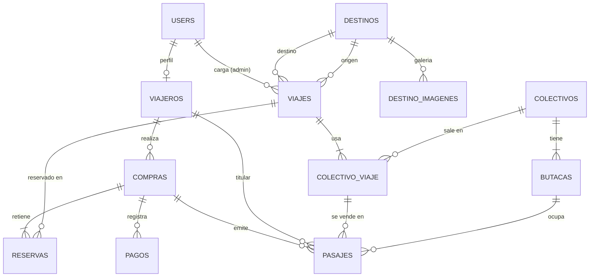

# VíaAliwén — Etapa 1: Análisis y diseño

> Documento de diseño del Trabajo Final de **Programación Web Dinámica**.
> Fija el modelo de datos y el funcionamiento de la aplicación antes de escribir código. Las etapas 2 a 9 lo implementan.

## Contexto

VíaAliwén es una empresa de transporte turístico de la provincia de Neuquén que vende sus propios pasajes de colectivo. Este documento revisa el modelo de datos propuesto por el enunciado, señala sus inconsistencias, presenta el modelo relacional definitivo y describe cómo funcionan las relaciones Eloquent, la disponibilidad de butacas, el carrito, el pago con Mercado Pago y la emisión de pasajes en PDF.

**Decisiones del grupo:** Laravel 13 · el origen del viaje es una FK a DESTINO · las fotos de las galerías provienen de Wikimedia Commons (con licencia libre, acreditadas en el README).

**Entorno de desarrollo:** PHP 8.4 (con pdo_mysql, gd, mbstring, intl, zip), Composer 2.10, MariaDB 10.11 de XAMPP (compatible con el driver `mysql` de Laravel; se administra con HeidiSQL), Node 26 / npm 12, Git.

---

## 1. Versiones y librerías

| Paquete | Versión | Observación |
|---|---|---|
| `laravel/laravel` | ^13 (actual 13.42) | Requiere PHP ≥ 8.3. Middleware y excepciones se registran en `bootstrap/app.php`. |
| `mercadopago/dx-php` | ^3.16 | **Corrección al requisito:** `mercadopago/sdk-php` **no existe en Packagist**; es el nombre del repositorio de GitHub. El SDK oficial se instala como `mercadopago/dx-php` (namespace `MercadoPago\`). |
| `barryvdh/laravel-dompdf` | ^3.1 | Soporta Laravel 13. El nombre alternativo `laravel/dompdf` tampoco existe. |
| Bootstrap 5.3 + Bootstrap Icons | npm, compilado con Vite | Reemplaza a Tailwind, que Laravel 13 trae por defecto. Así funciona sin internet durante la defensa. |

Métodos del SDK confirmados en su código fuente (no inventados): `MercadoPagoConfig::setAccessToken()`, `PreferenceClient::create(array)` y `get()`, `PaymentClient::get(int $id)` y `search(MPSearchRequest)`, `MPApiException::getApiResponse()->getStatusCode()/getContent()`.

---

## 2. Problemas detectados en el modelo propuesto y solución

| # | Problema | Solución |
|---|---|---|
| 1 | **SALE repite** ORIGEN, DESTINO, FECHA/HORARIO_SALIDA y LLEGADA_ESTIMADA, que ya están en VIAJE. Viola la 3FN: si cambia el horario del viaje hay que actualizarlo en varias filas (anomalía de actualización). | La tabla intermedia guarda sólo `(viaje_id, colectivo_id)`. Se llama `colectivo_viaje` (convención de Laravel) y corresponde a SALE. |
| 2 | **ORIGEN es texto libre** mientras DESTINO es una tabla. "Neuquén" y "Neuquen" serían orígenes distintos y las estadísticas por origen saldrían mal. | `viajes.origen_id` FK a `destinos`. Todo origen es una localidad neuquina cargada (p. ej. Neuquén Capital, Zapala). |
| 3 | **Fecha y hora en columnas separadas** (4 campos) complican comparar ("¿la llegada es posterior a la salida?", "¿el viaje ya salió?"). | Dos columnas `DATETIME`: `salida` y `llegada_estimada`. La llegada **se sigue cargando a mano** (input `datetime-local`), nunca se calcula. |
| 4 | **BUTACA con NRO_BUTACA como clave global**: la butaca 12 del colectivo A y la del B serían la misma fila. | `butacas(id, colectivo_id, numero)` con `UNIQUE(colectivo_id, numero)`. Cada colectivo tiene sus propias butacas 1..capacidad. |
| 5 | **BUTACA.DISPONIBILIDAD guardada** es incorrecta: un mismo colectivo hace varios viajes, y la butaca 12 puede estar libre en un viaje y vendida en otro. | La disponibilidad **no se guarda: se calcula** a partir de pasajes y reservas de cada viaje (sección 5). |
| 6 | **PASAJE sin ID_VIAJE**: un destino y un colectivo tienen muchos viajes, así que no se sabe qué viaje se compró. Además repite destino y horarios. | Se agrega `viaje_id`. Se quitan `destino_id` y horarios (se obtienen del viaje). El **precio sí se copia** al pasaje, porque debe conservar el valor pagado. |
| 7 | Si se cambia la fecha o el destino de un viaje con pasajes vendidos, los pasajes quedan incoherentes. | Un viaje **con ventas** sólo permite cambiar el precio (afecta compras futuras) y agregar colectivos. Origen, destino y fechas quedan bloqueados. |
| 8 | VIAJERO no tiene credenciales para iniciar sesión, y no hay roles. | `users` (email, contraseña, rol) 1:1 con `viajeros` (datos personales). El email vive sólo en `users`, así no se duplica. |
| 9 | No existe la **operación de compra**: no hay cómo agrupar los pasajes de un mismo pago ni vincularlo con Mercado Pago. | Tabla `compras` (su `referencia` es el `external_reference` de Mercado Pago) y `pagos` (cada intento informado por Mercado Pago). |
| 10 | Se habla de pasajes "reservados" pero no hay dónde guardarlos. Sin reserva, dos personas podrían pagar la misma butaca a la vez. | Tabla `reservas`: retiene las butacas de una compra **mientras el pago está pendiente** (15 min). No son pasajes; los pasajes se crean recién con el pago aprobado. |
| 11 | "Viaje realizado" no tiene atributo, y el requisito pide no deducirlo de los pasajes vendidos. | Se deriva de la fecha: realizado = `llegada_estimada` ya pasó. Programado = `salida` futura. Independiente de las ventas. |
| 12 | "Modificar viajes **que haya cargado**" exige saber quién cargó cada viaje. | `viajes.user_id` (admin creador) + `ViajePolicy`. Se siembran 2 administradores para demostrar la restricción. |
| 13 | Un colectivo podría asignarse a dos viajes que se superponen en el tiempo. | Al asociar (`attach`) se valida que el colectivo no tenga otro viaje en ese horario. |
| 14 | Pasajes nominales: el PDF lleva el nombre y DNI del viajero, así que dos butacas del mismo viaje a nombre de una misma persona no tienen sentido. | Regla: **una butaca por viaje y por viajero**. El carrito sí admite varios viajes distintos en una operación (lo que pide el requisito). |
| 15 | En local, Mercado Pago no puede enviar notificaciones (webhook) a `localhost`. | La compra se confirma consultando la API de Mercado Pago desde el servidor al volver del checkout, y con un botón "Verificar pago". El webhook queda implementado e idempotente; funciona con un túnel (ngrok) o en un servidor publicado. |

---

## 3. Modelo relacional definitivo

**Convenciones:** tablas en plural en español; PK `id` autoincremental; FK `<entidad>_id`. Seguir la convención de Laravel evita configuración extra, pero igual declaro `$table` y las claves en cada relación para que el código sea explícito y fácil de defender. Estados y roles se modelan con *Enums* de PHP (`App\Enums\Rol`, `EstadoColectivo`, `EstadoCompra`) y *casts* de Eloquent.

### Tablas

| Tabla | Columnas (PK **negrita**, FK *cursiva*) | Restricciones |
|---|---|---|
| `users` | **id**, email, password (hash), rol `ENUM('admin','viajero')`, remember_token, timestamps | email UNIQUE |
| `viajeros` | **id**, *user_id*, nombre, apellido, dni `VARCHAR(8)`, fecha_nacimiento `DATE`, timestamps | user_id UNIQUE (1:1) · dni UNIQUE · FK user ON DELETE CASCADE |
| `destinos` | **id**, nombre, descripcion `TEXT` (atractivos), destacado `BOOL`, timestamps | nombre UNIQUE |
| `destino_imagenes` | **id**, *destino_id*, ruta, epigrafe, credito (autor/licencia), orden, timestamps | FK destino ON DELETE CASCADE |
| `colectivos` | **id**, numero_interno, patente, capacidad `SMALLINT UNSIGNED`, estado `ENUM('operativo','baja')`, timestamps | numero_interno UNIQUE · patente UNIQUE |
| `butacas` | **id**, *colectivo_id*, numero | UNIQUE(colectivo_id, numero) · FK colectivo ON DELETE CASCADE |
| `viajes` | **id**, *destino_id*, *origen_id*, *user_id*, precio `DECIMAL(10,2)`, salida `DATETIME`, llegada_estimada `DATETIME`, timestamps | FK destino/origen → destinos RESTRICT · FK user RESTRICT · índice en salida |
| `colectivo_viaje` (= SALE) | ***viaje_id***, ***colectivo_id***, timestamps (fecha de asignación) | PK compuesta (viaje_id, colectivo_id) · FK viaje CASCADE · FK colectivo RESTRICT |
| `compras` | **id**, *viajero_id*, referencia `UUID`, total `DECIMAL(10,2)`, estado `ENUM('pendiente','aprobada','vencida','cancelada','conflicto')`, mp_preference_id, expira_en, pagada_en, timestamps | referencia UNIQUE |
| `reservas` | **id**, *compra_id*, *viaje_id*, *colectivo_id*, nro_butaca, precio (congelado al iniciar el pago) | UNIQUE(compra_id, viaje_id, colectivo_id, nro_butaca) · FK compra/viaje/colectivo CASCADE |
| `pagos` | **id**, *compra_id*, mp_payment_id `BIGINT`, estado (status de MP), estado_detalle, monto, medio_pago, fecha_aprobacion, timestamps | mp_payment_id UNIQUE (evita registrar dos veces la misma notificación) |
| `pasajes` | **id**, codigo, *compra_id*, *viajero_id*, *viaje_id*, *colectivo_id*, nro_butaca, precio (pagado), timestamps (`created_at` = fecha de emisión) | codigo UNIQUE · **UNIQUE(viaje_id, colectivo_id, nro_butaca)** · **FK compuesta (viaje_id, colectivo_id) → colectivo_viaje** · **FK compuesta (colectivo_id, nro_butaca) → butacas(colectivo_id, numero)** |

Además quedan las tablas internas de Laravel (`sessions`, `cache`, `jobs`, `password_reset_tokens`).

**Por qué las dos FK compuestas en `pasajes`:** la base de datos misma garantiza que (a) sólo se vendan pasajes en colectivos **asignados a ese viaje** y que (b) la butaca **exista en ese colectivo**. El índice único impide vender dos veces la misma butaca del mismo viaje y colectivo, aunque fallara el código. Bonus: no se puede quitar (`detach`) un colectivo de un viaje si ya tiene pasajes, porque la FK lo bloquea. Esto respeta la indicación del enunciado: el asiento se identifica por colectivo + número, no por número solo.

**Redundancias deliberadas (justificadas):**
- `colectivos.capacidad` coincide con la cantidad de butacas. Se conserva porque el requisito la pide y porque es la que **genera** las butacas. Se sincroniza en un único lugar (`ColectivoService`).
- `pasajes.viajero_id` se podría obtener de la compra. Se conserva porque el requisito pide `Viajero hasMany Pasaje`, y porque conceptualmente el titular del pasaje (pasajero) y el comprador son roles distintos, aunque hoy coincidan.
- `pasajes.precio` y `reservas.precio` copian el precio del viaje a propósito: el pasaje debe conservar lo que se pagó aunque el precio cambie después.

### Diagrama ER



### Cardinalidades

| Relación | Cardinalidad |
|---|---|
| User — Viajero | 1 : 0..1 (los admins no tienen perfil de viajero) |
| User (admin) — Viaje | 1 : N (viajes cargados) |
| Destino — DestinoImagen | 1 : N |
| Destino — Viaje (como destino) / (como origen) | 1 : N cada una |
| Viaje — Colectivo | **N : M** mediante `colectivo_viaje` |
| Colectivo — Butaca | 1 : N |
| Viajero — Compra · Viajero — Pasaje | 1 : N |
| Compra — Reserva · Compra — Pago · Compra — Pasaje | 1 : N |
| Viaje — Pasaje · Colectivo — Pasaje | 1 : N |

---

## 4. Relaciones Eloquent y dónde se usan

| Modelo | Relaciones | Uso real |
|---|---|---|
| `User` | `hasOne(Viajero)`, `hasMany(Viaje,'user_id')` viajesCargados | Navbar, `ViajePolicy` (¿es el creador?) |
| `Viajero` | `belongsTo(User)`, `hasMany(Compra)`, `hasMany(Pasaje)` | Historial "Mis compras", PDF |
| `Destino` | `hasMany(Viaje,'destino_id')` viajes, `hasMany(Viaje,'origen_id')` viajesDesde, `hasMany(DestinoImagen)` imagenes, `hasManyThrough(Pasaje, Viaje,'destino_id')` pasajes, `hasManyThrough(Pasaje, Viaje,'origen_id')` pasajesDesde | Galería (`with('imagenes')`), viajes del destino, estadísticas por destino y por origen (`withCount('pasajes')`, `withSum('pasajes','precio')`) |
| `DestinoImagen` | `belongsTo(Destino)` | Alta y baja de fotos |
| `Viaje` | `belongsTo(Destino,'destino_id')` destino, `belongsTo(Destino,'origen_id')` origen, `belongsTo(User,'user_id')` creador, `belongsToMany(Colectivo,'colectivo_viaje','viaje_id','colectivo_id')->withTimestamps()`, `hasMany(Pasaje)`, `hasMany(Reserva)`, `reservasActivas()` | Listados, disponibilidad, `attach()`/`detach()` desde el panel, pasajes vendidos por viaje |
| `Colectivo` | `belongsToMany(Viaje,'colectivo_viaje','colectivo_id','viaje_id')`, `hasMany(Butaca)`, `hasMany(Pasaje)` | Mapa de butacas, control de superposición horaria, scope `operativos()` |
| `Butaca` | `belongsTo(Colectivo)` | Generación y mapa de asientos |
| `Compra` | `belongsTo(Viajero)`, `hasMany(Reserva)`, `hasMany(Pago)`, `hasMany(Pasaje)` | Checkout, confirmación del pago, historial |
| `Reserva` · `Pago` · `Pasaje` | `belongsTo` a sus padres | Disponibilidad, idempotencia, PDF |

**Requisitos académicos de relaciones:** 1:N (Destino–Viaje, entre otras), N:M con tabla intermedia y `attach`/`detach` (Viaje–Colectivo), una tercera relación distinta (1:1 User–Viajero) y además `hasManyThrough` para las estadísticas. Scopes del modelo: `Viaje::programados()`, `Viaje::realizados()`, `Colectivo::operativos()`.

---

## 5. Disponibilidad de butacas y carrito

### Regla de disponibilidad (`App\Services\DisponibilidadService`)

```
ocupadas(V, C) = butacas con pasaje en (V, C)
               ∪ butacas reservadas en (V, C) por compras 'pendiente' cuya expira_en > ahora
libres(V, C)   = C.capacidad − |ocupadas(V, C)|     (0 si C está en BAJA)
V disponible   ⇔ V.salida > ahora  Y  existe C operativo asociado a V con libres(V, C) > 0
```

Cubre las 10 reglas del punto 7: colectivo en BAJA = 0 libres; un colectivo lleno deja de vender; un viaje sin colectivos con lugar desaparece de listados y búsquedas. Se calcula con Eloquent y relaciones precargadas (`with`), sin SQL manual. Con el volumen de un TP (decenas o cientos de viajes) alcanza. Si el volumen creciera, se pasaría a una subconsulta (lo dejo documentado como mejora).

### Carrito (`App\Services\CarritoService`, guardado en la sesión)

- Cada ítem guarda sólo **IDs**: `viaje_id`, `colectivo_id`, `nro_butaca`. El precio **siempre se lee de la base**, así el viajero no puede manipularlo.
- **Agregar** (`AgregarAlCarritoRequest` + servicio): viaje futuro; colectivo asociado al viaje y operativo; butaca existente en ese colectivo; butaca libre (sin pasaje ni reserva activa); no repetida en el carrito; el viajero no tiene ya una butaca en ese viaje.
- **Ver**: destino, origen, fecha y hora, colectivo, butaca, precio individual y total. Los ítems que dejaron de ser válidos (viaje lleno, colectivo dado de baja) se marcan con un aviso.
- **Quitar** un ítem, **seguir comprando** o **pagar**.
- **Selección de butaca**: mapa de asientos en disposición 2+2 dibujado con JavaScript. Las ocupadas se cargan por `fetch` desde `GET /viajes/{viaje}/colectivos/{colectivo}/butacas` (JSON). Un visitante puede ver el mapa, pero para agregar al carrito se le pide iniciar sesión o registrarse.

---

## 6. Flujo de pago (Mercado Pago Checkout Pro) y PDF

```
pendiente ──(pago aprobado y verificado)──► aprobada ──► se emiten los pasajes
    │──(vence a los 15 min sin aprobación)──► vencida      (libera las butacas)
    │──(el viajero cancela)─────────────────► cancelada    (libera las butacas)
    └──(aprobado, pero la butaca ya se vendió)► conflicto  (sin pasajes; se avisa para reintegro)
```

1. **Iniciar pago** (`POST /checkout`, `CheckoutService`), dentro de `DB::transaction`:
   - Marca como vencidas las compras pendientes expiradas.
   - **Bloquea** los viajes involucrados: `Viaje::whereIn(...)->orderBy('id')->lockForUpdate()`. Dos compradores del mismo viaje quedan en fila; el segundo ya ve la reserva del primero. El orden por id evita deadlocks.
   - **Revalida** cada ítem: fecha, colectivo, butaca, disponibilidad y precio actual.
   - Crea la `Compra` (pendiente, total, `expira_en` = ahora + 15 min) y sus `reservas` con el precio congelado (`$compra->reservas()->createMany()`).
2. **Fuera de la transacción**, para no retener bloqueos durante una llamada HTTP: `MercadoPagoService` crea la preferencia con `PreferenceClient::create()`. Datos: un ítem por butaca (ARS), email del pagador, `external_reference` = `compra.referencia`, `back_urls`, `notification_url`, `expires = true` y `expiration_date_to` = `expira_en` (no se puede pagar una reserva vencida). Se guarda `mp_preference_id`, se vacía el carrito y se redirige al checkout de Mercado Pago. Si Mercado Pago falla, la compra pasa a cancelada y se muestra el error.
3. **Confirmación** (`ConfirmacionPagoService::procesarPago(int $paymentId)`), invocada desde la vuelta del checkout, el webhook o el botón "Verificar pago":
   - **Nunca confía en el `status` que llega por la URL del navegador.** Consulta el pago a la API con `PaymentClient::get($id)` y obtiene la compra por el `external_reference` que devuelve Mercado Pago.
   - En transacción: bloquea la compra (`lockForUpdate`) y registra el intento con `Pago::updateOrCreate(['mp_payment_id' => ...])`.
   - Si el estado **no es `approved`** (rechazado, pendiente, cancelado), no hace nada más. La compra sigue pendiente: el checkout permite reintentar con otra tarjeta hasta que venza.
   - Si la compra **ya está aprobada**, termina ahí (**idempotencia**: notificaciones repetidas no duplican pasajes).
   - Verifica que el monto y la moneda coincidan con `compra.total`. Bloquea los viajes, revisa que las butacas sigan libres, crea los `pasajes` desde las reservas (código único, precio de la reserva) y marca la compra como `aprobada`.
   - Último resguardo: el índice único de `pasajes`. Una `UniqueConstraintViolationException` revierte todo y la compra pasa a `conflicto`.
4. **Webhook** `POST /webhooks/mercadopago`: excluido de CSRF en `bootstrap/app.php`. Si se configura `MERCADOPAGO_WEBHOOK_SECRET`, valida la firma `x-signature`. Siempre responde 200 y registra los errores en el log.
5. **Credenciales** sólo en `.env` (`MERCADOPAGO_ACCESS_TOKEN`, `MERCADOPAGO_WEBHOOK_SECRET`, `MERCADOPAGO_AUTO_RETURN`), leídas desde `config/services.php`. Nunca llegan al frontend; Checkout Pro por redirección no necesita la public key. `auto_return` es configurable porque Mercado Pago puede rechazarlo con URLs `localhost`; sin él, el usuario vuelve con el botón "Volver al sitio".
6. **Pruebas:** usuarios de prueba vendedor y comprador creados en el panel de desarrolladores de Mercado Pago y tarjetas de prueba (titular `APRO` = aprobado, `OTHE` = rechazado, `CONT` = pendiente). Verifico los datos vigentes en la documentación oficial durante la Etapa 6.

### PDF (`barryvdh/laravel-dompdf`)

- `PasajeController@pdf` → `Pdf::loadView('pdf.pasaje', ...)->download("pasaje-{codigo}.pdf")`. **Un PDF por pasaje.** Como los pasajes sólo existen después de un pago aprobado y verificado, es imposible generar uno antes.
- Se genera al momento de descargar, sin archivos guardados que mantener. Se descarga desde "Mis compras".
- La plantilla está pensada para DomPDF: tablas, CSS en línea, fuente DejaVu Sans (muestra bien "í" y "é"), logo como archivo local y colores de la marca. Contiene todos los datos del punto 10: empresa, código del pasaje, viajero, DNI, origen, destino, salida, llegada estimada, número interno del colectivo, butaca, precio pagado, referencia de compra y fecha de emisión.
- Protección: middleware `auth` + `rol:viajero` + `PasajePolicy@download` (el pasaje debe ser del viajero autenticado; si no, 403).

---

## 7. Autenticación, roles y seguridad

- **Autenticación manual** con `AuthController` y `RegistroController`, usando `Auth::attempt`, regeneración de sesión al entrar y al salir, y `throttle` en el login. Sin Breeze: Breeze trae Tailwind y choca con Bootstrap, y el código propio es más fácil de explicar en la defensa.
- **Registro** = `User` (rol viajero, contraseña con cast `hashed`) + `$user->viajero()->create()` dentro de una transacción. Validaciones: email válido y único, DNI de 7 a 8 dígitos y único, fecha de nacimiento anterior a hoy, contraseña confirmada.
- **Middleware** `EnsureUserHasRole`, con alias `rol` en `bootstrap/app.php`. Grupos de rutas en `web.php`: públicas · `guest` · `auth + rol:viajero` (carrito, checkout, compras, perfil) · `auth + rol:admin` con prefijo `/admin`.
- **Policies** (se descubren automáticamente): `ViajePolicy` (sólo el admin creador edita y elimina; para eliminar no debe haber pasajes ni reservas activas), `CompraPolicy` y `PasajePolicy` (sólo el dueño). Se usa `Gate::authorize()`, porque en Laravel 13 el `Controller` base no trae `AuthorizesRequests`.
- **Perfil:** siempre se edita `auth()->user()->viajero`, nunca un id que venga en la URL, así nadie puede modificar los datos de otro. DNI y email quedan de sólo lectura.
- CSRF en todos los formularios, consultas Eloquent con *bindings*, FormRequests con mensajes en español (`lang/es/validation.php`) y zona horaria `America/Argentina/Buenos_Aires`.

---

## 8. Panel administrativo y estadísticas

- **CRUD**: destinos (y sus fotos: subida múltiple al disco `public`, borrado del archivo), colectivos (al crear se generan las butacas; dar de baja o reactivar; reducir la capacidad sólo si las butacas quitadas no tienen pasajes; eliminar sólo si nunca se usó), viajes (crear con al menos un colectivo, editar con los bloqueos del punto 2.7, eliminar según la policy) y viajeros (sólo lectura: el admin tampoco modifica datos personales).
- **Detalle de un viaje (admin):** colectivos asignados, con **Asignar** (`attach`, validando estado operativo y superposición horaria) y **Quitar** (`detach`, bloqueado si hay pasajes o reservas activas); ocupación por colectivo (gestión de butacas); pasajes vendidos.
- **Dashboard** (datos reales, vía Eloquent): total de viajes, programados y realizados (por fecha, no por ventas); destinos; colectivos operativos; pasajes vendidos y recaudación; ventas por destino y por origen (`hasManyThrough` + `withCount`/`withSum`); pasajes por viaje.

---

## 9. AJAX: búsqueda dinámica de viajes

- `GET /viajes/buscar`, pública, responde JSON. `BuscarViajesRequest` valida: `q` (texto, máx. 60), `origen_id` y `destino_id` (deben existir), `fecha` (hoy o posterior).
- Consulta con Eloquent: búsqueda por nombre de destino u origen con `whereHas` + `with`, filtro por fecha y el filtro de disponibilidad de la sección 5. Máximo 30 resultados.
- `resources/js/busqueda-viajes.js` usa `fetch` con espera de 300 ms entre tecleos, cancela la búsqueda anterior con `AbortController` y envía `Accept: application/json` para recibir los 422 como JSON. Muestra un indicador de carga, la cantidad de resultados y tarjetas con los viajes; si no hay coincidencias, un mensaje de "sin resultados"; y ante un error, un aviso. Escapa el contenido para evitar XSS.
- Segundo uso de AJAX: el mapa de butacas (sección 5).

---

## 10. Interfaz

Fondo blanco; header, navbar y footer en azules (azul lago patagónico); botones secundarios y detalles en verdes (bosque andino). Layouts `layouts/app` y `layouts/admin`; partials `header`, `footer`, `alerts`; componentes Blade (`viaje-card`, `destino-card`, `stat-card`). Inicio con una foto principal grande, el buscador, destinos destacados y próximos viajes. Galería por destino con carrusel y miniaturas que se amplían. Páginas 403/404 con la estética del sitio. Diseño adaptable a computadora, tablet y celular.

---

## 11. Estructura de carpetas

```
TP-Final-PWD/
├─ app/
│  ├─ Enums/                Rol, EstadoColectivo, EstadoCompra
│  ├─ Http/
│  │  ├─ Controllers/       HomeController, DestinoController, ViajeController (index, show,
│  │  │                     buscar, butacas), CarritoController, CheckoutController,
│  │  │                     PagoController (retorno, verificar, cancelar),
│  │  │                     WebhookMercadoPagoController, CompraController, PasajeController,
│  │  │                     PerfilController
│  │  │  ├─ Auth/           AuthController, RegistroController
│  │  │  └─ Admin/          DashboardController, DestinoController, DestinoImagenController,
│  │  │                     ColectivoController, ViajeController, ViajeColectivoController,
│  │  │                     ViajeroController
│  │  ├─ Middleware/        EnsureUserHasRole
│  │  └─ Requests/          Login, Registro, Perfil, Destino, DestinoImagen, Colectivo, Viaje,
│  │                        AsignarColectivo, AgregarAlCarrito, BuscarViajes
│  ├─ Models/               User, Viajero, Destino, DestinoImagen, Colectivo, Butaca, Viaje,
│  │                        Compra, Reserva, Pago, Pasaje
│  ├─ Policies/             ViajePolicy, CompraPolicy, PasajePolicy
│  └─ Services/             DisponibilidadService, CarritoService, CheckoutService,
│                           MercadoPagoService, ConfirmacionPagoService, ColectivoService
├─ bootstrap/app.php        alias 'rol', CSRF except webhook
├─ config/services.php      claves de Mercado Pago desde .env
├─ database/
│  ├─ migrations/           una por tabla, en orden de dependencias
│  └─ seeders/              User, Destino (+ fotos), Colectivo (+ butacas), Viaje (+ attach),
│                           HistorialVentas;  imagenes/ (fotos CC de Wikimedia)
├─ resources/
│  ├─ css/app.css · js/app.js, busqueda-viajes.js, selector-butacas.js
│  └─ views/   layouts/ partials/ components/ auth/ destinos/ viajes/ carrito/ compras/
│              perfil/ admin/{dashboard,destinos,colectivos,viajes,viajeros}/ pdf/ errors/
├─ routes/web.php · routes/console.php (comando compras:vencer)
├─ lang/es/validation.php
├─ docs/ETAPA-1-analisis-y-diseno.md
├─ .env.example · README.md
```

**Seeders:** 10 destinos neuquinos con 3 o 4 fotos cada uno; 6 colectivos (uno en BAJA); viajes futuros y pasados; **un viaje completo** y **otro sólo con un colectivo en BAJA** (para mostrar que no aparecen); un historial de ventas de demostración para que el dashboard tenga datos (documentado como datos de prueba); 2 administradores y 3 viajeros con contraseñas ficticias (`password`), dominio `@viaaliwen.test`.

---

## 12. Etapas siguientes (resumen; cada una se aprueba por separado)

| Etapa | Entregable | Verificación |
|---|---|---|
| 2 | Proyecto Laravel, `git init`, `.env` con MySQL, migraciones, modelos, relaciones, seeders y descarga de fotos | `php artisan migrate:fresh --seed` sin errores; revisar las FK en HeidiSQL; `tinker` para probar relaciones |
| 3 | Login, registro, logout, roles, middleware, policies | Visitante, viajero y admin acceden sólo a lo suyo (403 / redirección) |
| 4 | CRUD de destinos, colectivos y viajes; attach/detach; butacas; disponibilidad | Viaje completo o en BAJA no aparece; no se puede hacer detach con ventas |
| 5 | Layouts, inicio, galerías, listados, panel | Revisión visual en el navegador integrado, en escritorio y celular |
| 6 | Mapa de butacas, carrito, checkout, Mercado Pago, confirmación | Pago `APRO` emite pasajes; `OTHE` no; webhook repetido no duplica; dos sesiones compitiendo por la misma butaca |
| 7 | Plantilla PDF y descargas protegidas | Un PDF por pasaje; un viajero no puede bajar el PDF de otro (403) |
| 8 | Búsqueda AJAX y estadísticas | JSON correcto, 422 ante parámetros inválidos, mensaje de sin resultados; números del dashboard contra la base |
| 9 | Pruebas de punta a punta, README completo (los 15 puntos), `.gitignore` | Instalación desde cero siguiendo el README |

